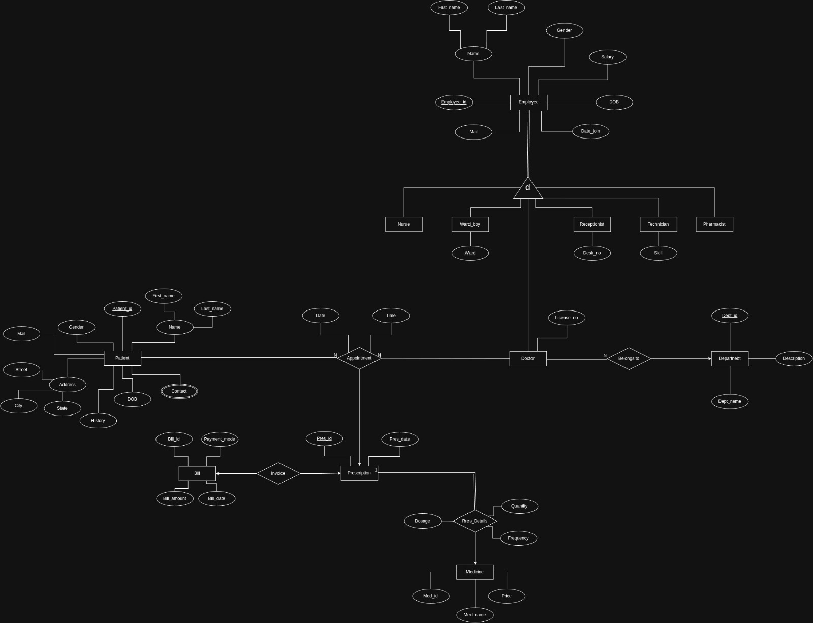
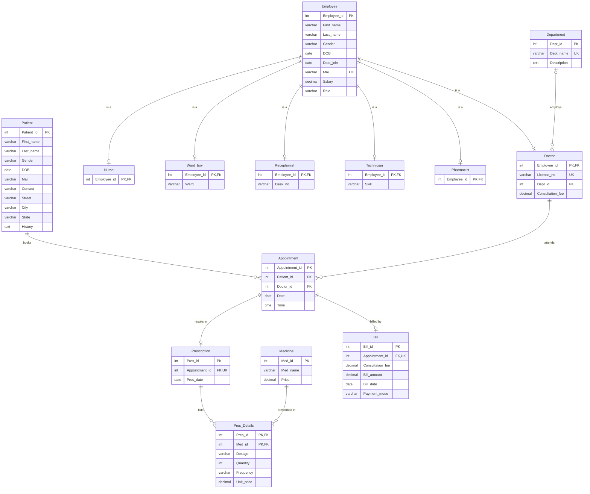

# HealthStack Database

HealthStack is a MySQL database for a hospital: staff, patients, appointments, prescriptions, medicines and billing. This document covers:

1. [The ER design](#1-er-design)
2. [The implemented tables](#2-implemented-tables)
3. [Triggers and what each one does](#3-triggers)
4. [The transaction plan and how to implement it](#4-transaction-plan)

**Files**

| File | Contents |
|---|---|
| [`schema/table.sql`](../schema/table.sql) | Creates the `healthstack` database and all 14 tables |
| [`triggers/triggers.sql`](../triggers/triggers.sql) | Validation and billing triggers (see [3.3](#33-known-issues) before running) |
| [`triggers/triggers.local.sql`](../triggers/triggers.local.sql) | Alternative trigger set that matches the current `table.sql` |
| [`seed/seed.sql`](../seed/seed.sql) | Sample data: 2 departments, 2 doctors, 3 medicines |
| [`docs/strategy.md`](strategy.md) | ACID definitions |
| [`docs/diagrams/`](diagrams/) | ER diagram and transaction plan images |

**Run order:** `table.sql`, then one trigger file, then `seed.sql`. Requires **MySQL 8.0.16 or later**, because older versions silently ignore `CHECK` constraints.

Run these from the repository root:

```bash
mysql -u root -p < schema/table.sql
mysql -u root -p healthstack < triggers/triggers.local.sql
mysql -u root -p healthstack < seed/seed.sql
```

---

## 1. ER Design



### 1.1 Entities

| Entity | Key | Attributes | Notes |
|---|---|---|---|
| **Employee** | `Employee_id` | Name (`First_name`, `Last_name`), `Gender`, `DOB`, `Date_join`, `Mail`, `Salary` | `Name` is a composite attribute |
| **Doctor** | (inherited) | `License_no` | Subclass of Employee |
| **Nurse** | (inherited) | (none) | Subclass of Employee |
| **Ward_boy** | (inherited) | `Ward` | Subclass of Employee |
| **Receptionist** | (inherited) | `Desk_no` | Subclass of Employee |
| **Technician** | (inherited) | `Skill` | Subclass of Employee |
| **Pharmacist** | (inherited) | (none) | Subclass of Employee |
| **Patient** | `Patient_id` | Name (`First_name`, `Last_name`), `Gender`, `DOB`, `Mail`, Address (`Street`, `City`, `State`), `Contact`, `History` | `Address` is composite; `Contact` is drawn as **multivalued** (double ellipse) |
| **Department** | `Dept_id` | `Dept_name`, `Description` | Spelled "Departnebt" in the diagram |
| **Prescription** | `Pres_id` | `Pres_date` | |
| **Medicine** | `Med_id` | `Med_name`, `Price` | |
| **Bill** | `Bill_id` | `Bill_amount`, `Bill_date`, `Payment_mode` | |

### 1.2 Specialisation

Employee is specialised into **Doctor, Nurse, Ward_boy, Receptionist, Technician and Pharmacist**.

- The circle is marked **d** (disjoint): an employee belongs to at most one subclass.
- The double line from Employee to the circle means **total** participation: every employee belongs to some subclass.

### 1.3 Relationships

| Relationship | Between | Cardinality / participation | Attributes |
|---|---|---|---|
| **Appointment** | Patient and Doctor | N : N; Patient participates totally (double line) | `Date`, `Time` |
| **Belongs to** | Doctor and Department | N : 1; Doctor participates totally (double line) | (none) |
| (Appointment leads to Prescription) | Appointment and Prescription | Each appointment produces at most one prescription | (none) |
| **Pres_Details** | Prescription and Medicine | Many-to-many; Prescription participates totally (at least one medicine) | `Dosage`, `Quantity`, `Frequency` |
| **Invoice** | Bill and Prescription | 1 : 1 | (none) |

### 1.4 How the ER maps to tables

| ER construct | Mapping used |
|---|---|
| Composite attributes (`Name`, `Address`) | Flattened into their parts (`First_name`, `Last_name`, `Street`, `City`, `State`) |
| Specialisation | One table per subclass. Its primary key is also a foreign key to `Employee` (`ON DELETE CASCADE`) |
| N : N **Appointment** | Its own table with a surrogate key `Appointment_id` and foreign keys to Patient and Doctor |
| N : 1 **Belongs to** | Foreign key `Dept_id` in `Doctor` |
| Appointment leads to Prescription | `Prescription.Appointment_id`, declared `UNIQUE` (one prescription per appointment) |
| M : N **Pres_Details** | Junction table with composite primary key (`Pres_id`, `Med_id`) |
| 1 : 1 **Invoice** | `Bill.Appointment_id`, declared `UNIQUE` (see deviation 1 below) |

### 1.5 Where the tables differ from the ER diagram

These were deliberate. Update the diagram to match, or change the tables back.

1. **Bill links to Appointment, not Prescription.** This lets an appointment with no prescription be billed for the consultation alone. It also lets the bill include the doctor's fee, which the transaction plan (T3) requires.
2. **New columns not in the diagram:**
   - `Employee.Role`: which subclass an employee belongs to.
   - `Doctor.Consultation_fee`.
   - `Pres_Details.Unit_price`: the medicine price at the time it was prescribed.
   - `Bill.Consultation_fee`.
3. **`Contact` is a single column, but the diagram draws it as multivalued.** A faithful mapping would be a separate `Patient_Contact(Patient_id, Contact)` table.
4. **Doctor's participation in *Belongs to* is total in the diagram**, but `Doctor.Dept_id` allows NULL and is set to NULL when a department is deleted. Make it `NOT NULL` with `ON DELETE RESTRICT` to match the diagram.
5. **Some total participations can't be enforced with plain constraints:**
   - every patient having an appointment;
   - every employee having a subclass row;
   - every prescription having at least one medicine.

   The transaction procedures in section 4 enforce the last two at the point of creation.

---

## 2. Implemented Tables

### 2.1 Schema diagram



### 2.2 Tables and constraints

| Table | Primary key | Foreign keys (on delete) | Other constraints |
|---|---|---|---|
| `Department` | `Dept_id` | (none) | `Dept_name` unique, not null |
| `Employee` | `Employee_id` | (none) | `Mail` unique; `Gender` must be Male, Female or Other; `Salary >= 0`; `Role` must be one of the six subclasses; `Date_join > DOB` |
| `Doctor` | `Employee_id` | `Employee` (cascade), `Department` (set null) | `License_no` unique; `Consultation_fee >= 0`, default 0 |
| `Nurse`, `Pharmacist` | `Employee_id` | `Employee` (cascade) | (none) |
| `Ward_boy` | `Employee_id` | `Employee` (cascade) | `Ward` not null |
| `Receptionist` | `Employee_id` | `Employee` (cascade) | `Desk_no` not null |
| `Technician` | `Employee_id` | `Employee` (cascade) | `Skill` not null |
| `Patient` | `Patient_id` | (none) | `Gender` must be Male, Female or Other; `Contact` not null |
| `Appointment` | `Appointment_id` | `Patient` (restrict), `Doctor` (restrict) | Unique (`Doctor_id`, `Date`, `Time`) and unique (`Patient_id`, `Date`, `Time`): no double-booking |
| `Prescription` | `Pres_id` | `Appointment` (restrict) | `Appointment_id` unique: one prescription per appointment |
| `Medicine` | `Med_id` | (none) | `Price >= 0` |
| `Pres_Details` | (`Pres_id`, `Med_id`) | `Prescription` (cascade), `Medicine` (restrict) | `Quantity > 0`; `Unit_price >= 0` |
| `Bill` | `Bill_id` | `Appointment` (restrict) | `Appointment_id` unique: one bill per appointment; amounts `>= 0`; `Payment_mode` must be Cash, Card, UPI, Insurance or NetBanking |

### 2.3 Design decisions

- **Medical and billing records are never deleted by accident.** `Appointment`, `Prescription` and `Bill` all use `ON DELETE RESTRICT`. A patient, doctor or appointment that has history cannot be deleted. Deleting an employee who is a doctor with appointments is blocked as well.
- **Old bills don't change when medicine prices change.** `Pres_Details.Unit_price` records the price at the time of prescribing. The bill is calculated from that recorded price, not from `Medicine.Price`.
- **Bill total** = `Consultation_fee` + sum of (`Quantity` × `Unit_price`) for the appointment's prescription.
- **The script can be re-run.** `table.sql` drops existing tables in reverse dependency order before creating them.

---

## 3. Triggers

A trigger rejects a change by raising `SIGNAL SQLSTATE '45000'` with a message. This undoes the statement, and inside a transaction the procedures in section 4 then roll back the whole transaction.

### 3.1 `triggers.sql`

| Trigger(s) | Table, event | Role |
|---|---|---|
| `trg_employee_validate_before_insert` / `_update` | Employee, before insert / update | DOB must be in the past. `Date_join` must be on or after DOB and not in the future |
| `trg_patient_validate_before_insert` / `_update` | Patient, before insert / update | DOB must be in the past. A `CHECK` can't do this because `CHECK` can't use `CURRENT_DATE()` |
| `trg_<subclass>_disjoint_before_insert` / `_update` (12 triggers) | Doctor, Nurse, Ward_boy, Receptionist, Technician, Pharmacist | Rejects the row if the employee is already in any of the other five subclass tables. This enforces the **disjoint** specialisation |
| `trg_appointment_check_slot_before_insert` / `_update` | Appointment, before insert / update | Rejects a booking when the doctor or patient already has an appointment at that exact date and time. It gives a clearer error than the `UNIQUE` constraint, which still catches the case where two bookings arrive at the same moment |
| `trg_prescription_validate_before_insert` / `_update` | Prescription, before insert / update | `Pres_date` cannot be before the appointment date |
| `trg_bill_calculate_before_insert` / `_update` | Bill, before insert / update | Calculates `Bill_amount` from the prescription's medicines. Rejects a bill dated before the prescription. **Written for the old schema** (see 3.3) |
| `trg_pres_details_freeze_before_insert` / `_update` / `_delete` | Pres_Details | Blocks any change to a prescription's medicines once a bill exists. **Written for the old schema** (see 3.3) |

### 3.2 `triggers.local.sql`

This set matches the current `table.sql`.

| Trigger(s) | Table, event | Role |
|---|---|---|
| `check_employee_role` (procedure) and `trg_<subclass>_role` (6 triggers) | Each subclass table, before insert | Accepts the row only if `Employee.Role` matches the table. This enforces the disjoint specialisation through `Role` |
| `trg_employee_role_lock` | Employee, before update | Blocks a change to `Role` while the employee still has a row in a subclass table |
| `trg_pres_details_bi` | Pres_Details, before insert | Sets `Unit_price` from `Medicine.Price`. Blocks adding medicines once the appointment is billed |
| `trg_pres_details_bu` / `_bd` | Pres_Details, before update / delete | Blocks changes once billed. On update, looks the price up again only if the medicine itself changed |
| `trg_prescription_bi` | Prescription, before insert | `Pres_date` cannot be before the appointment date |
| `trg_prescription_bd` | Prescription, before delete | Blocks deleting a billed prescription. This is needed because MySQL does **not** fire triggers on rows removed by a cascade, so the `Pres_Details` delete trigger would be bypassed |
| `trg_bill_bi` | Bill, before insert | Copies the doctor's `Consultation_fee` and sets `Bill_amount` = fee + medicine total. Rejects a bill dated before the appointment |
| `trg_bill_bu` | Bill, before update | Lets you correct `Bill_date` and `Payment_mode`. Keeps both amounts unchanged, and blocks moving a bill to another appointment |
| `trg_patient_dob_bi` / `_bu` | Patient, before insert / update | DOB cannot be in the future |

### 3.3 Known issues

The bill and prescription-lock triggers in `triggers.sql` don't match the current `table.sql`:

- `trg_bill_calculate_*` and `trg_pres_details_freeze_*` use `Bill.Pres_id`. **`Bill` no longer has that column**; it has `Appointment_id`. These triggers will fail, either when the file is loaded or the first time they run.
- `trg_bill_calculate_*` uses the current `Medicine.Price` instead of `Pres_Details.Unit_price`, and leaves out the consultation fee. Its update trigger also recalculates the total every time a bill is updated, so recording a payment would change an old bill's amount.
- `triggers.sql` has no `USE healthstack;` and no `DROP TRIGGER IF EXISTS`. Running it a second time fails with "trigger already exists".
- If both trigger files are loaded, the subclass checks run twice. They don't conflict, but pick one file.

**Suggested fix:** keep the validation, disjoint and slot triggers from `triggers.sql`, and replace its bill and lock triggers with the ones in `triggers.local.sql`.

### 3.4 Other triggers that could be added

| Idea | Needs |
|---|---|
| Log changes to medicine prices and salaries (old value, new value, user, time) | A `Price_log` / `Salary_log` table and an `AFTER UPDATE` trigger |
| Reduce medicine stock when medicines are prescribed; reject when out of stock | A `Medicine.Stock` column |
| Reject prescriptions and bills for cancelled appointments | `Appointment.Status` (see 4.2) |
| Keep ward occupancy within capacity | `Ward` and `Admission` tables (see T5) |
| Employees at least 18 years old at joining | Nothing new; an extra check in the employee trigger |
| Add a note to `Patient.History` when a prescription is created | Nothing new; an `AFTER INSERT` trigger on Pres_Details |

---

## 4. Transaction Plan

### 4.1 The plan

From [`diagrams/TransactionPlan_1.jpeg`](diagrams/TransactionPlan_1.jpeg) and [`diagrams/TransactionPlan_2.jpeg`](diagrams/TransactionPlan_2.jpeg). The second image ends with "…", so the plan may continue beyond T6.

| ID | Workflow (actor) | Tables affected | Purpose / risk mitigated |
|---|---|---|---|
| T1 | Patient registration | `Patient` | Registration completes fully, with no orphan records |
| T2 | Slot booking (patient) | `Appointment` | Row-level locking prevents double-booking a doctor at the same date and time |
| T3 | Appointment completion and auto-billing (doctor) | `Appointment`, `Prescription`, `Pres_Details`, `Medicine`, `Bill` | Creates the prescription, records the medicines, calculates (medicine total + doctor fee) and generates the invoice, all at once |
| T4 | Employee onboarding (admin) | `Employee` + one subclass table | The `Employee` row and its subclass row are created together |
| T5 | Ward allocation (nurse) | `Patient`, `Ward_boy` | Assigns a patient to a ward without exceeding its capacity |
| T6 | Bill payment settlement (patient / reception) | `Bill` | Marks the bill as paid and records the payment mode |

### 4.2 Schema additions needed

T1, T2 and T4 work on the current schema. T3, T5 and T6 need columns or tables that don't exist yet:

| Transaction | Missing | Why |
|---|---|---|
| T3 | `Appointment.Status` | To mark an appointment as completed |
| T5 | `Ward` table with a capacity, `Admission` table | The only ward data today is the free-text `Ward_boy.Ward`. Nothing records which patient is in which ward, or how many beds a ward has |
| T6 | `Bill.Payment_status`, `Bill.Paid_date`; `Payment_mode` allowed to be empty until payment | `Bill` has no paid / unpaid state, and `Payment_mode` currently has to be chosen when the bill is created |

```sql
-- T3: appointment lifecycle
ALTER TABLE Appointment
    ADD COLUMN Status VARCHAR(20) NOT NULL DEFAULT 'Scheduled'
        CHECK (Status IN ('Scheduled', 'Completed', 'Cancelled'));

-- T6: payment state (the existing CHECK on Payment_mode still applies once it is set)
ALTER TABLE Bill
    MODIFY Payment_mode VARCHAR(50) NULL,
    ADD COLUMN Payment_status VARCHAR(10) NOT NULL DEFAULT 'Pending'
        CHECK (Payment_status IN ('Pending', 'Paid')),
    ADD COLUMN Paid_date DATE NULL,
    ADD CHECK (Payment_status = 'Pending' OR Payment_mode IS NOT NULL);

-- T5: wards and admissions
CREATE TABLE Ward (
    Ward_id INT PRIMARY KEY AUTO_INCREMENT,
    Ward_name VARCHAR(50) UNIQUE NOT NULL,
    Capacity INT NOT NULL CHECK (Capacity > 0)
);

CREATE TABLE Admission (
    Admission_id INT PRIMARY KEY AUTO_INCREMENT,
    Patient_id INT NOT NULL,
    Ward_id INT NOT NULL,
    Nurse_id INT NOT NULL,
    Admit_date DATE NOT NULL,
    Discharge_date DATE,
    CHECK (Discharge_date IS NULL OR Discharge_date >= Admit_date),
    FOREIGN KEY (Patient_id) REFERENCES Patient(Patient_id) ON DELETE RESTRICT,
    FOREIGN KEY (Ward_id) REFERENCES Ward(Ward_id) ON DELETE RESTRICT,
    FOREIGN KEY (Nurse_id) REFERENCES Nurse(Employee_id) ON DELETE RESTRICT
);
```

`Ward_boy.Ward` could then become a foreign key to `Ward(Ward_id)`. The plan lists `Ward_boy` under T5, but the ward boy only says which ward a staff member works in. The patient-to-ward link is `Admission`.

With `Status` added, a cancelled appointment still occupies its slot because of the `UNIQUE` constraint. Either delete or reschedule the cancelled row, or drop the `UNIQUE` and rely on the slot trigger with a `Status <> 'Cancelled'` condition.

### 4.3 How ACID is achieved

| Property | How it's achieved in MySQL (InnoDB) |
|---|---|
| **Atomicity** | Each workflow is a stored procedure that wraps its statements in `START TRANSACTION … COMMIT`. An `EXIT HANDLER FOR SQLEXCEPTION` runs `ROLLBACK` and then `RESIGNAL`, so any error, including a trigger's `SIGNAL`, undoes the whole workflow and still reports the error to the caller |
| **Consistency** | `CHECK`, `UNIQUE` and foreign key constraints, plus the triggers in section 3 |
| **Isolation** | InnoDB's default `REPEATABLE READ` level, plus locking reads (`SELECT … FOR UPDATE`). These lock the row that two transactions would otherwise race on (the doctor, the ward or the bill), so the second transaction waits for the first to finish |
| **Durability** | InnoDB writes the redo log to disk on every commit (`innodb_flush_log_at_trx_commit = 1`, the default) |

**Rules followed in every procedure:**

- **Lock first, check second, write last.** The check is only reliable while the row is locked.
- **Lock rows in the same order everywhere** (Patient, then Doctor, then Appointment) to avoid deadlocks. If MySQL still reports a deadlock (error 1213), the application should retry the call.
- **Keep transactions short.** Never wait for user input inside one.
- **No `ALTER` or `CREATE` inside a transaction.** Schema changes commit implicitly.

Every procedure below uses this error-handling block:

```sql
DECLARE EXIT HANDLER FOR SQLEXCEPTION
BEGIN
    ROLLBACK;
    RESIGNAL;
END;
```

### 4.4 Implementation of each transaction

#### T1: Patient registration

On the current schema this is a single `INSERT`, which is already atomic. Wrapping it in a procedure gives one entry point and the same error handling as the others. The transaction starts to matter once `Contact` is stored in a separate `Patient_Contact` table, as the ER diagram suggests. The patient row and its contact rows then have to be inserted together, so that no contacts are left without a patient and no patient is left without contacts.

```sql
DELIMITER $$
CREATE PROCEDURE register_patient(
    IN p_first VARCHAR(50), IN p_last VARCHAR(50), IN p_gender VARCHAR(10),
    IN p_dob DATE, IN p_mail VARCHAR(100), IN p_contact VARCHAR(20),
    IN p_street VARCHAR(100), IN p_city VARCHAR(50), IN p_state VARCHAR(50),
    IN p_history TEXT, OUT p_patient_id INT)
BEGIN
    DECLARE EXIT HANDLER FOR SQLEXCEPTION
    BEGIN
        ROLLBACK;
        RESIGNAL;
    END;

    START TRANSACTION;
    INSERT INTO Patient (First_name, Last_name, Gender, DOB, Mail, Contact, Street, City, State, History)
    VALUES (p_first, p_last, p_gender, p_dob, p_mail, p_contact, p_street, p_city, p_state, p_history);
    SET p_patient_id = LAST_INSERT_ID();
    -- With Patient_Contact: INSERT INTO Patient_Contact ... here, inside the same transaction
    COMMIT;
END$$
DELIMITER ;

CALL register_patient('Ravi', 'Kumar', 'Male', '1995-04-12', 'ravi@example.com', '9876543210',
                      'MG Road', 'Indore', 'Madhya Pradesh', NULL, @pid);
SELECT @pid;
```

#### T2: Slot booking

**The risk:** two patients request Dr. Mehta at 10:00 at the same moment. Both check, both see the slot as free, and both insert.

**The fix:** lock the patient's row and then the doctor's row with `FOR UPDATE`. A second booking for the same doctor waits until the first commits, and then its check sees the new appointment. The `UNIQUE (Doctor_id, Date, Time)` constraint catches anything that still gets through.

```sql
DELIMITER $$
CREATE PROCEDURE book_appointment(
    IN p_patient_id INT, IN p_doctor_id INT, IN p_date DATE, IN p_time TIME,
    OUT p_appointment_id INT)
BEGIN
    DECLARE v_patient INT;
    DECLARE v_doctor INT;
    DECLARE EXIT HANDLER FOR SQLEXCEPTION
    BEGIN
        ROLLBACK;
        RESIGNAL;
    END;

    START TRANSACTION;

    -- Lock in a fixed order: patient, then doctor
    SELECT Patient_id INTO v_patient FROM Patient WHERE Patient_id = p_patient_id FOR UPDATE;
    IF v_patient IS NULL THEN
        SIGNAL SQLSTATE '45000' SET MESSAGE_TEXT = 'Patient not found';
    END IF;

    SELECT Employee_id INTO v_doctor FROM Doctor WHERE Employee_id = p_doctor_id FOR UPDATE;
    IF v_doctor IS NULL THEN
        SIGNAL SQLSTATE '45000' SET MESSAGE_TEXT = 'Doctor not found';
    END IF;

    IF EXISTS (SELECT 1 FROM Appointment
               WHERE `Date` = p_date AND `Time` = p_time
                 AND (Doctor_id = p_doctor_id OR Patient_id = p_patient_id)) THEN
        SIGNAL SQLSTATE '45000' SET MESSAGE_TEXT = 'Slot already booked';
    END IF;

    INSERT INTO Appointment (Patient_id, Doctor_id, `Date`, `Time`)
    VALUES (p_patient_id, p_doctor_id, p_date, p_time);
    SET p_appointment_id = LAST_INSERT_ID();

    COMMIT;
END$$
DELIMITER ;

CALL book_appointment(1, 101, '2026-11-02', '10:00:00', @appt);
```

#### T3: Appointment completion and auto-billing

This is the most important transaction. It writes to four tables, and they must succeed or fail together:

1. Lock the appointment and check that it is still `Scheduled`. This stops it being completed twice.
2. If medicines were prescribed:
   - insert the `Prescription`;
   - insert each `Pres_Details` row, recording the medicine's current price as `Unit_price`.
3. Insert the `Bill`, with `Bill_amount` = doctor's consultation fee + sum of (`Quantity` × `Unit_price`).
4. Mark the appointment `Completed`.

If any step fails, everything is rolled back. Examples: an unknown medicine, a duplicate medicine, a quantity of 0, or a trigger rejecting a date. You can't end up with a prescription that has no bill, or a bill with no medicines.

The medicines are passed as a JSON array and expanded with `JSON_TABLE` (MySQL 8). An empty array or `NULL` means a consultation-only bill.

```sql
DELIMITER $$
CREATE PROCEDURE complete_appointment(IN p_appointment_id INT, IN p_meds JSON, OUT p_bill_id INT)
BEGIN
    DECLARE v_status VARCHAR(20);
    DECLARE v_doctor_id INT;
    DECLARE v_fee DECIMAL(10, 2);
    DECLARE v_pres_id INT;
    DECLARE v_meds_total DECIMAL(10, 2) DEFAULT 0;
    DECLARE EXIT HANDLER FOR SQLEXCEPTION
    BEGIN
        ROLLBACK;
        RESIGNAL;
    END;

    START TRANSACTION;

    -- 1. Lock the appointment so it can't be completed twice concurrently
    SELECT Status, Doctor_id INTO v_status, v_doctor_id
    FROM Appointment WHERE Appointment_id = p_appointment_id
    FOR UPDATE;

    IF v_status IS NULL THEN
        SIGNAL SQLSTATE '45000' SET MESSAGE_TEXT = 'Appointment not found';
    ELSEIF v_status <> 'Scheduled' THEN
        SIGNAL SQLSTATE '45000' SET MESSAGE_TEXT = 'Appointment is not in Scheduled state';
    END IF;

    SELECT Consultation_fee INTO v_fee FROM Doctor WHERE Employee_id = v_doctor_id;

    -- 2. Prescription and its medicines
    IF p_meds IS NOT NULL AND JSON_LENGTH(p_meds) > 0 THEN
        INSERT INTO Prescription (Appointment_id, Pres_date) VALUES (p_appointment_id, CURDATE());
        SET v_pres_id = LAST_INSERT_ID();

        INSERT INTO Pres_Details (Pres_id, Med_id, Dosage, Quantity, Frequency, Unit_price)
        SELECT v_pres_id, j.med_id, j.dosage, j.quantity, j.frequency, m.Price
        FROM JSON_TABLE(p_meds, '$[*]' COLUMNS (
                 med_id    INT         PATH '$.med_id',
                 dosage    VARCHAR(50) PATH '$.dosage',
                 quantity  INT         PATH '$.quantity',
                 frequency VARCHAR(50) PATH '$.frequency')) AS j
        JOIN Medicine AS m ON m.Med_id = j.med_id;

        -- The JOIN silently drops unknown medicine ids, so make sure every line was inserted
        IF ROW_COUNT() <> JSON_LENGTH(p_meds) THEN
            SIGNAL SQLSTATE '45000' SET MESSAGE_TEXT = 'Prescription contains an unknown medicine';
        END IF;

        SELECT SUM(Quantity * Unit_price) INTO v_meds_total
        FROM Pres_Details WHERE Pres_id = v_pres_id;
    END IF;

    -- 3. Invoice: doctor fee + medicines
    INSERT INTO Bill (Appointment_id, Consultation_fee, Bill_amount, Bill_date, Payment_status)
    VALUES (p_appointment_id, v_fee, v_fee + v_meds_total, CURDATE(), 'Pending');
    SET p_bill_id = LAST_INSERT_ID();

    -- 4. Close the appointment
    UPDATE Appointment SET Status = 'Completed' WHERE Appointment_id = p_appointment_id;

    COMMIT;
END$$
DELIMITER ;

-- Dr. Mehta (fee 800) prescribes 10 × Atorvastatin (15.50) and 14 × Aspirin (5.00)
CALL complete_appointment(1, '[
    {"med_id": 1, "dosage": "10mg", "quantity": 10, "frequency": "Once daily"},
    {"med_id": 2, "dosage": "75mg", "quantity": 14, "frequency": "Once daily"}
]', @bill);
-- Bill_amount = 800 + 155 + 70 = 1025.00
```

The triggers in `triggers.local.sql` (`trg_pres_details_bi`, `trg_bill_bi`) calculate the same values, so the procedure and the triggers agree. The triggers also protect the data when rows are inserted without going through this procedure.

#### T4: Employee onboarding

An `Employee` row without its subclass row would be an orphan. That breaks the ER's total specialisation: for example, a "doctor" with no licence number. Both inserts go in one transaction. If the subclass insert fails, for example because the licence number is a duplicate, the `Employee` row is rolled back as well.

```sql
DELIMITER $$
CREATE PROCEDURE onboard_doctor(
    IN p_first VARCHAR(50), IN p_last VARCHAR(50), IN p_gender VARCHAR(10),
    IN p_dob DATE, IN p_join DATE, IN p_mail VARCHAR(100), IN p_salary DECIMAL(10, 2),
    IN p_license VARCHAR(50), IN p_dept_id INT, IN p_fee DECIMAL(10, 2),
    OUT p_employee_id INT)
BEGIN
    DECLARE EXIT HANDLER FOR SQLEXCEPTION
    BEGIN
        ROLLBACK;
        RESIGNAL;
    END;

    START TRANSACTION;
    INSERT INTO Employee (First_name, Last_name, Gender, DOB, Date_join, Mail, Salary, Role)
    VALUES (p_first, p_last, p_gender, p_dob, p_join, p_mail, p_salary, 'Doctor');
    SET p_employee_id = LAST_INSERT_ID();

    INSERT INTO Doctor (Employee_id, License_no, Dept_id, Consultation_fee)
    VALUES (p_employee_id, p_license, p_dept_id, p_fee);
    COMMIT;
END$$
DELIMITER ;
```

The other roles follow the same pattern with their own subclass columns: `onboard_nurse`, `onboard_ward_boy(… p_ward)`, `onboard_receptionist(… p_desk_no)`, `onboard_technician(… p_skill)` and `onboard_pharmacist`.

#### T5: Ward allocation

Needs the `Ward` and `Admission` tables from 4.2.

**The risk:** a ward has one bed left and two nurses admit patients at the same moment. Both count the occupied beds, both see one free, and the ward ends up over capacity.

**The fix:** lock the ward's row with `FOR UPDATE` before counting. The second nurse's transaction waits, then counts again and sees the ward is full. Locking the patient's row first also stops the same patient being admitted to two wards at once.

```sql
DELIMITER $$
CREATE PROCEDURE admit_patient(
    IN p_patient_id INT, IN p_ward_id INT, IN p_nurse_id INT, OUT p_admission_id INT)
BEGIN
    DECLARE v_patient INT;
    DECLARE v_capacity INT;
    DECLARE v_occupied INT;
    DECLARE EXIT HANDLER FOR SQLEXCEPTION
    BEGIN
        ROLLBACK;
        RESIGNAL;
    END;

    START TRANSACTION;

    SELECT Patient_id INTO v_patient FROM Patient WHERE Patient_id = p_patient_id FOR UPDATE;
    IF v_patient IS NULL THEN
        SIGNAL SQLSTATE '45000' SET MESSAGE_TEXT = 'Patient not found';
    END IF;

    IF EXISTS (SELECT 1 FROM Admission WHERE Patient_id = p_patient_id AND Discharge_date IS NULL) THEN
        SIGNAL SQLSTATE '45000' SET MESSAGE_TEXT = 'Patient is already admitted';
    END IF;

    SELECT Capacity INTO v_capacity FROM Ward WHERE Ward_id = p_ward_id FOR UPDATE;
    IF v_capacity IS NULL THEN
        SIGNAL SQLSTATE '45000' SET MESSAGE_TEXT = 'Ward not found';
    END IF;

    SELECT COUNT(*) INTO v_occupied FROM Admission
    WHERE Ward_id = p_ward_id AND Discharge_date IS NULL;
    IF v_occupied >= v_capacity THEN
        SIGNAL SQLSTATE '45000' SET MESSAGE_TEXT = 'Ward is full';
    END IF;

    INSERT INTO Admission (Patient_id, Ward_id, Nurse_id, Admit_date)
    VALUES (p_patient_id, p_ward_id, p_nurse_id, CURDATE());
    SET p_admission_id = LAST_INSERT_ID();

    COMMIT;
END$$
DELIMITER ;
```

Discharge is the matching transaction: `UPDATE Admission SET Discharge_date = CURDATE() WHERE Admission_id = ? AND Discharge_date IS NULL`.

#### T6: Bill payment settlement

Needs the `Bill` columns from 4.2.

**The risk:** the patient pays online while the receptionist records a cash payment, and the bill is settled twice.

**The fix:** lock the bill's row, check that it is still `Pending`, then mark it paid. The second attempt waits, sees `Paid` and is rejected. `trg_bill_bu` in `triggers.local.sql` allows this update but keeps the amounts unchanged.

```sql
DELIMITER $$
CREATE PROCEDURE settle_bill(IN p_bill_id INT, IN p_payment_mode VARCHAR(50))
BEGIN
    DECLARE v_status VARCHAR(10);
    DECLARE EXIT HANDLER FOR SQLEXCEPTION
    BEGIN
        ROLLBACK;
        RESIGNAL;
    END;

    START TRANSACTION;

    SELECT Payment_status INTO v_status FROM Bill WHERE Bill_id = p_bill_id FOR UPDATE;
    IF v_status IS NULL THEN
        SIGNAL SQLSTATE '45000' SET MESSAGE_TEXT = 'Bill not found';
    ELSEIF v_status = 'Paid' THEN
        SIGNAL SQLSTATE '45000' SET MESSAGE_TEXT = 'Bill is already paid';
    END IF;

    -- The CHECK on Payment_mode rejects anything other than Cash/Card/UPI/Insurance/NetBanking
    UPDATE Bill
    SET Payment_status = 'Paid', Payment_mode = p_payment_mode, Paid_date = CURDATE()
    WHERE Bill_id = p_bill_id;

    COMMIT;
END$$
DELIMITER ;

CALL settle_bill(@bill, 'UPI');
```

### 4.5 Summary

| ID | Procedure | Lock taken | Prevents | Schema ready? |
|---|---|---|---|---|
| T1 | `register_patient` | (none) | Partial registration | Yes |
| T2 | `book_appointment` | Patient row, Doctor row | Double-booking | Yes |
| T3 | `complete_appointment` | Appointment row | Prescription without a bill; wrong totals; completing twice | Needs `Appointment.Status`, `Bill.Payment_status` |
| T4 | `onboard_doctor` (one per role) | (none) | Employee without a subclass row | Yes |
| T5 | `admit_patient` | Patient row, Ward row | Over-capacity wards; double admission | Needs `Ward`, `Admission` |
| T6 | `settle_bill` | Bill row | Paying twice | Needs `Bill.Payment_status`, `Paid_date` |
