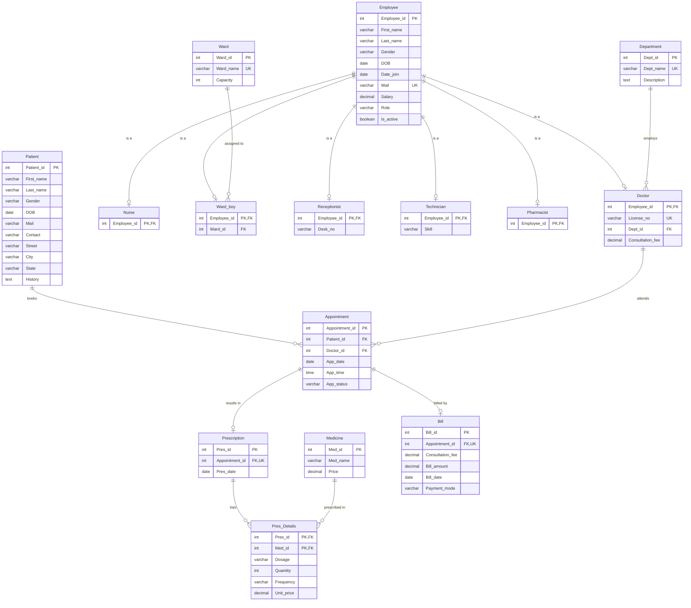

# HealthStack Database

HealthStack is a MySQL database for a hospital: staff, patients, appointments, prescriptions, medicines and billing. This document covers:

1. [The ER design](#1-er-design)
2. [The implemented tables](#2-implemented-tables)
3. [Triggers and what each one does](#3-triggers)
4. [The transaction plan and how to implement it](#4-transaction-plan)

**Files**

| File                                                | Contents                                                                     |
| --------------------------------------------------- | ---------------------------------------------------------------------------- |
| [`schema/table.sql`](../schema/table.sql)           | Creates the `healthstack` database and all 14 tables                         |
| [`triggers/triggers.sql`](../triggers/triggers.sql) | Validation and billing triggers (see [3.3](#33-known-issues) before running) |
| [`seed/seed.sql`](../seed/seed.sql)                 | Sample data: 2 departments, 2 doctors, 3 medicines                           |
| [`docs/DATABASE.md`](DATABASE.md)                   | This File                                                                    |
| [`docs/diagrams/`](diagrams/)                       | ER diagram and transaction plan images                                       |

**Run order:** `table.sql`, then one trigger file, then `seed.sql`. Requires **MySQL 8.0.16 or later**, because older versions silently ignore `CHECK` constraints.

Run these from the repository root:

```bash
mysql -u root -p < schema/table.sql
mysql -u root -p healthstack < triggers/triggers.local.sql
mysql -u root -p healthstack < seed/seed.sql
```

---

## 1. ER Design


### 1.1 Entities

| Entity           | Key           | Attributes                                                                                                           | Notes                                                                          |
| ---------------- | ------------- | -------------------------------------------------------------------------------------------------------------------- | ------------------------------------------------------------------------------ |
| **Employee**     | `Employee_id` | Name (`First_name`, `Last_name`), `Gender`, `DOB`, `Date_join`, `Mail`, `Salary`                                     | `Name` is a composite attribute                                                |
| **Doctor**       | (inherited)   | `License_no`                                                                                                         | Subclass of Employee                                                           |
| **Nurse**        | (inherited)   | (none)                                                                                                               | Subclass of Employee                                                           |
| **Ward_boy**     | (inherited)   | `Ward`                                                                                                               | Subclass of Employee; implemented as a link to the `Ward` table (see 1.5)     |
| **Receptionist** | (inherited)   | `Desk_no`                                                                                                            | Subclass of Employee                                                           |
| **Technician**   | (inherited)   | `Skill`                                                                                                              | Subclass of Employee                                                           |
| **Pharmacist**   | (inherited)   | (none)                                                                                                               | Subclass of Employee                                                           |
| **Patient**      | `Patient_id`  | Name (`First_name`, `Last_name`), `Gender`, `DOB`, `Mail`, Address (`Street`, `City`, `State`), `Contact`, `History` | `Address` is composite; `Contact` is drawn as **multivalued** (double ellipse) |
| **Department**   | `Dept_id`     | `Dept_name`, `Description`                                                                                           | Spelled "Departnebt" in the diagram                                            |
| **Prescription** | `Pres_id`     | `Pres_date`                                                                                                          |                                                                                |
| **Medicine**     | `Med_id`      | `Med_name`, `Price`                                                                                                  |                                                                                |
| **Bill**         | `Bill_id`     | `Bill_amount`, `Bill_date`, `Payment_mode`                                                                           |                                                                                |

### 1.2 Specialisation

Employee is specialised into **Doctor, Nurse, Ward_boy, Receptionist, Technician and Pharmacist**.

- The circle is marked **d** (disjoint): an employee belongs to at most one subclass.
- The double line from Employee to the circle means **total** participation: every employee belongs to some subclass.

### 1.3 Relationships

| Relationship                        | Between                      | Cardinality / participation                                             | Attributes                        |
| ----------------------------------- | ---------------------------- | ----------------------------------------------------------------------- | --------------------------------- |
| **Appointment**                     | Patient and Doctor           | N : N; Patient participates totally (double line)                       | `Date`, `Time`                    |
| **Belongs to**                      | Doctor and Department        | N : 1; Doctor participates totally (double line)                        | (none)                            |
| (Appointment leads to Prescription) | Appointment and Prescription | Each appointment produces at most one prescription                      | (none)                            |
| **Pres_Details**                    | Prescription and Medicine    | Many-to-many; Prescription participates totally (at least one medicine) | `Dosage`, `Quantity`, `Frequency` |
| **Invoice**                         | Bill and Prescription        | 1 : 1                                                                   | (none)                            |

### 1.4 How the ER maps to tables

| ER construct                             | Mapping used                                                                                      |
| ---------------------------------------- | ------------------------------------------------------------------------------------------------- |
| Composite attributes (`Name`, `Address`) | Flattened into their parts (`First_name`, `Last_name`, `Street`, `City`, `State`)                 |
| Specialisation                           | One table per subclass. Its primary key is also a foreign key to `Employee` (`ON DELETE CASCADE`) |
| N : N **Appointment**                    | Its own table with a surrogate key `Appointment_id` and foreign keys to Patient and Doctor        |
| N : 1 **Belongs to**                     | Foreign key `Dept_id` in `Doctor`                                                                 |
| Appointment leads to Prescription        | `Prescription.Appointment_id`, declared `UNIQUE` (one prescription per appointment)               |
| M : N **Pres_Details**                   | Junction table with composite primary key (`Pres_id`, `Med_id`)                                   |
| 1 : 1 **Invoice**                        | `Bill.Appointment_id`, declared `UNIQUE` (see deviation 1 below)                                  |

### 1.5 Where the tables differ from the ER diagram

These were deliberate. Update the diagram to match, or change the tables back.

1. **Bill links to Appointment, not Prescription.** This lets an appointment with no prescription be billed for the consultation alone. It also lets the bill include the doctor's fee, which the transaction plan (T3) requires.
2. **New columns not in the diagram:**
   - `Employee.Role`: which subclass an employee belongs to.
   - `Doctor.Consultation_fee`.
   - `Pres_Details.Unit_price`: the medicine price at the time it was prescribed.
   - `Bill.Consultation_fee`.
   - `Employee.Is_active`: false once an employee leaves (see 2.3).
3. **`Contact` is a single column, but the diagram draws it as multivalued.** A faithful mapping would be a separate `Patient_Contact(Patient_id, Contact)` table.
4. **Ward_boy's `Ward` is a relationship, not an attribute.** `Ward_boy.Ward_id` is a foreign key to a separate `Ward` table (`Ward_id`, `Ward_name`, `Capacity`), so a ward boy can only be assigned to a ward that exists. In the diagram this is an N : 1 _Assigned to_ relationship, with Ward_boy participating totally.
5. **Appointment columns are renamed** to `App_date`, `App_time` and `App_status`, because `Date`, `Time` and `Status` are SQL keywords.
6. **Some total participations can't be enforced with plain constraints:**
   - every patient having an appointment;
   - every employee having a subclass row;
   - every prescription having at least one medicine.

   The transaction procedures in section 4 enforce the last two at the point of creation.

---

## 2. Implemented Tables

### 2.1 Schema diagram



### 2.2 Tables and constraints

| Table                 | Primary key           | Foreign keys (on delete)                        | Other constraints                                                                                                                  |
| --------------------- | --------------------- | ----------------------------------------------- | ---------------------------------------------------------------------------------------------------------------------------------- |
| `Department`          | `Dept_id`             | (none)                                          | `Dept_name` unique, not null                                                                                                       |
| `Employee`            | `Employee_id`         | (none)                                          | `Mail` unique; `Gender` must be Male, Female or Other; `Salary >= 0`; `Role` must be one of the six subclasses; `Date_join > DOB`; `Is_active` default true |
| `Doctor`              | `Employee_id`         | `Employee` (cascade), `Department` (restrict)   | `License_no` unique; `Dept_id` not null; `Consultation_fee >= 0`, default 200                                                      |
| `Nurse`, `Pharmacist` | `Employee_id`         | `Employee` (cascade)                            | (none)                                                                                                                             |
| `Ward`                | `Ward_id`             | (none)                                          | `Ward_name` unique, not null; `Capacity > 0`                                                                                       |
| `Ward_boy`            | `Employee_id`         | `Employee` (cascade), `Ward` (restrict)         | `Ward_id` not null                                                                                                                 |
| `Receptionist`        | `Employee_id`         | `Employee` (cascade)                            | `Desk_no` not null                                                                                                                 |
| `Technician`          | `Employee_id`         | `Employee` (cascade)                            | `Skill` not null                                                                                                                   |
| `Patient`             | `Patient_id`          | (none)                                          | `Gender` must be Male, Female or Other; `Contact` not null                                                                         |
| `Appointment`         | `Appointment_id`      | `Patient` (restrict), `Doctor` (restrict)       | `App_status` must be Scheduled, Completed or Cancelled. Unique (`Doctor_id`, `App_date`, `App_time`, `Active_slot`) and the same for `Patient_id`: no double-booking. `Active_slot` is a generated column that is NULL for cancelled appointments, so a cancelled slot can be booked again |
| `Prescription`        | `Pres_id`             | `Appointment` (restrict)                        | `Appointment_id` unique: one prescription per appointment                                                                          |
| `Medicine`            | `Med_id`              | (none)                                          | `Price >= 0`                                                                                                                       |
| `Pres_Details`        | (`Pres_id`, `Med_id`) | `Prescription` (cascade), `Medicine` (restrict) | `Quantity > 0`; `Unit_price >= 0`                                                                                                  |
| `Bill`                | `Bill_id`             | `Appointment` (restrict)                        | `Appointment_id` unique: one bill per appointment; amounts `>= 0`; `Payment_mode` must be Cash, Card, UPI, Insurance or NetBanking |

### 2.3 Design decisions

- **Old bills don't change when medicine prices change.** `Pres_Details.Unit_price` records the price at the time of prescribing. The bill is calculated from that recorded price, not from `Medicine.Price`.
- **Bill total** = `Consultation_fee` + sum of (`Quantity` × `Unit_price`) for the appointment's prescription.
- **Employees are deactivated, not deleted.** Deleting an employee who has appointments or admissions is blocked by `ON DELETE RESTRICT`, which keeps their history. Set `Is_active = false` instead; new appointments and admissions then reject that doctor or nurse.
- **The script can be re-run.** `table.sql` drops existing tables in reverse dependency order before creating them.

---

## 3. Triggers

A trigger rejects a change by raising `SIGNAL SQLSTATE '45000'` with a message. This undoes the statement, and inside a transaction the procedures in section 4 then roll back the whole transaction.

### 3.1 `triggers.sql`

| Trigger(s)                                                        | Table, event                                                  | Role                                                                                                                                                                                                                                  |
| ----------------------------------------------------------------- | ------------------------------------------------------------- | ------------------------------------------------------------------------------------------------------------------------------------------------------------------------------------------------------------------------------------- |
| `trg_employee_validate_before_insert` / `_update`                 | Employee, before insert / update                              | DOB must be in the past. `Date_join` must be on or after DOB and not in the future                                                                                                                                                    |
| `trg_patient_validate_before_insert` / `_update`                  | Patient, before insert / update                               | DOB must be in the past. A `CHECK` can't do this because `CHECK` can't use `CURRENT_DATE()`                                                                                                                                           |
| `trg_<subclass>_disjoint_before_insert` / `_update` (12 triggers) | Doctor, Nurse, Ward_boy, Receptionist, Technician, Pharmacist | Rejects the row if the employee is already in any of the other five subclass tables. This enforces the **disjoint** specialisation                                                                                                    |
| `trg_appointment_check_slot_before_insert` / `_update`            | Appointment, before insert / update                           | Rejects a booking when the doctor or patient already has an appointment at that exact date and time. It gives a clearer error than the `UNIQUE` constraint, which still catches the case where two bookings arrive at the same moment |
| `trg_prescription_validate_before_insert` / `_update`             | Prescription, before insert / update                          | `Pres_date` cannot be before the appointment date                                                                                                                                                                                     |
| `trg_bill_calculate_before_insert` / `_update`                    | Bill, before insert / update                                  | Calculates `Bill_amount` from the prescription's medicines. Rejects a bill dated before the prescription. **Written for the old schema** (see 3.3)                                                                                    |
| `trg_pres_details_freeze_before_insert` / `_update` / `_delete`   | Pres_Details                                                  | Blocks any change to a prescription's medicines once a bill exists. **Written for the old schema** (see 3.3)                                                                                                                          |

### 3.2 `triggers.local.sql`

This set matches the current `table.sql`.

| Trigger(s)                                                               | Table, event                         | Role                                                                                                                                                                                |
| ------------------------------------------------------------------------ | ------------------------------------ | ----------------------------------------------------------------------------------------------------------------------------------------------------------------------------------- |
| `check_employee_role` (procedure) and `trg_<subclass>_role` (6 triggers) | Each subclass table, before insert   | Accepts the row only if `Employee.Role` matches the table. This enforces the disjoint specialisation through `Role`                                                                 |
| `trg_employee_role_lock`                                                 | Employee, before update              | Blocks a change to `Role` while the employee still has a row in a subclass table                                                                                                    |
| `trg_pres_details_bi`                                                    | Pres_Details, before insert          | Sets `Unit_price` from `Medicine.Price`. Blocks adding medicines once the appointment is billed                                                                                     |
| `trg_pres_details_bu` / `_bd`                                            | Pres_Details, before update / delete | Blocks changes once billed. On update, looks the price up again only if the medicine itself changed                                                                                 |
| `trg_prescription_bi` / `_bu`                                            | Prescription, before insert / update | Rejects a cancelled appointment. `Pres_date` cannot be before the appointment date                                                                                                  |
| `trg_prescription_bd`                                                    | Prescription, before delete          | Blocks deleting a billed prescription. This is needed because MySQL does **not** fire triggers on rows removed by a cascade, so the `Pres_Details` delete trigger would be bypassed |
| `trg_bill_bi`                                                            | Bill, before insert                  | Rejects a cancelled appointment. Copies the doctor's `Consultation_fee` and sets `Bill_amount` = fee + medicine total. Rejects a bill dated before the appointment                    |
| `trg_bill_bu`                                                            | Bill, before update                  | Lets you correct `Bill_date` and `Payment_mode`. Keeps both amounts unchanged, and blocks moving a bill to another appointment                                                      |
| `trg_patient_dob_bi` / `_bu`                                             | Patient, before insert / update      | DOB cannot be in the future                                                                                                                                                         |
| `trg_appointment_bi` / `_bu`                                             | Appointment, before insert / update  | The doctor must be active. An appointment with a prescription or bill cannot be cancelled                                                                                           |
| `trg_admission_bi`                                                       | Admission, before insert             | The nurse must be active                                                                                                                                                            |

### 3.3 Known issues

The bill and prescription-lock triggers in `triggers.sql` don't match the current `table.sql`:

- `trg_bill_calculate_*` and `trg_pres_details_freeze_*` use `Bill.Pres_id`. **`Bill` no longer has that column**; it has `Appointment_id`. These triggers will fail, either when the file is loaded or the first time they run.
- `trg_bill_calculate_*` uses the current `Medicine.Price` instead of `Pres_Details.Unit_price`, and leaves out the consultation fee. Its update trigger also recalculates the total every time a bill is updated, so recording a payment would change an old bill's amount.
- `triggers.sql` has no `USE healthstack;` and no `DROP TRIGGER IF EXISTS`. Running it a second time fails with "trigger already exists".
- If both trigger files are loaded, the subclass checks run twice. They don't conflict, but pick one file.

**Suggested fix:** keep the validation, disjoint and slot triggers from `triggers.sql`, and replace its bill and lock triggers with the ones in `triggers.local.sql`.

### 3.4 Other triggers that could be added

| Idea                                                                           | Needs                                                            |
| ------------------------------------------------------------------------------ | ---------------------------------------------------------------- |
| Log changes to medicine prices and salaries (old value, new value, user, time) | A `Price_log` / `Salary_log` table and an `AFTER UPDATE` trigger |
| Reduce medicine stock when medicines are prescribed; reject when out of stock  | A `Medicine.Stock` column                                        |
| Keep ward occupancy within capacity                                            | `Ward` and `Admission` tables (see T5)                           |
| Employees at least 18 years old at joining                                     | Nothing new; an extra check in the employee trigger              |
| Add a note to `Patient.History` when a prescription is created                 | Nothing new; an `AFTER INSERT` trigger on Pres_Details           |

---

## 4. Transactions

### 4.1 The plan

From [`diagrams/TransactionPlan_1.jpeg`](diagrams/TransactionPlan_1.jpeg) and [`diagrams/TransactionPlan_2.jpeg`](diagrams/TransactionPlan_2.jpeg). The second image ends with "…", so the plan may continue beyond T6.

| ID  | Workflow (actor)                                 | Tables affected                                                   | Purpose / risk mitigated                                                                                                         |
| --- | ------------------------------------------------ | ----------------------------------------------------------------- | -------------------------------------------------------------------------------------------------------------------------------- |
| T1  | Patient registration                             | `Patient`                                                         | Registration completes fully, with no orphan records                                                                             |
| T2  | Slot booking (patient)                           | `Appointment`                                                     | Row-level locking prevents double-booking a doctor at the same date and time                                                     |
| T3  | Appointment completion and auto-billing (doctor) | `Appointment`, `Prescription`, `Pres_Details`, `Medicine`, `Bill` | Creates the prescription, records the medicines, calculates (medicine total + doctor fee) and generates the invoice, all at once |
| T4  | Employee onboarding (admin)                      | `Employee` + one subclass table                                   | The `Employee` row and its subclass row are created together                                                                     |
| T5  | Ward allocation (nurse)                          | `Patient`, `Ward_boy`                                             | Assigns a patient to a ward without exceeding its capacity                                                                       |
| T6  | Bill payment settlement (patient / reception)    | `Bill`                                                            | Marks the bill as paid and records the payment mode                                                                              |

### 4.2 How ACID will be achieved

| Property        | How it's achieved in MySQL (InnoDB)                                                                                                                                                                                                                                                      |
| --------------- | ---------------------------------------------------------------------------------------------------------------------------------------------------------------------------------------------------------------------------------------------------------------------------------------- |
| **Atomicity**   | Each workflow is a stored procedure that wraps its statements in `START TRANSACTION … COMMIT`. An `EXIT HANDLER FOR SQLEXCEPTION` runs `ROLLBACK` and then `RESIGNAL`, so any error, including a trigger's `SIGNAL`, undoes the whole workflow and still reports the error to the caller |
| **Consistency** | `CHECK`, `UNIQUE` and foreign key constraints, plus the triggers in section 3                                                                                                                                                                                                            |
| **Isolation**   | InnoDB's default `REPEATABLE READ` level, plus locking reads (`SELECT … FOR UPDATE`). These lock the row that two transactions would otherwise race on (the doctor, the ward or the bill), so the second transaction waits for the first to finish                                       |
| **Durability**  | InnoDB writes the redo log to disk on every commit (`innodb_flush_log_at_trx_commit = 1`, the default)                                                                                                                                                                                   |

**Rules followed in every procedure:**

- **Lock first, check second, write last.** The check is only reliable while the row is locked.
- **Lock rows in the same order everywhere** (Patient, then Doctor, then Appointment) to avoid deadlocks. If MySQL still reports a deadlock (error 1213), the application should retry the call.
- **Keep transactions short.** Never wait for user input inside one.
- **No `ALTER` or `CREATE` inside a transaction.** Schema changes commit implicitly.

Every procedure below uses this error-handling block:

```sql
DECLARE EXIT HANDLER FOR SQLEXCEPTION
BEGIN
    ROLLBACK;
    RESIGNAL;
END;
```

### 4.3 Summary

| ID  | Procedure                       | Lock taken              | Prevents                                                    |
| --- | ------------------------------- | ----------------------- | ----------------------------------------------------------- |
| T1  | `register_patient`              | (none)                  | Partial registration                                        |
| T2  | `book_appointment`              | Patient row, Doctor row | Double-booking                                              |
| T3  | `complete_appointment`          | Appointment row         | Prescription without a bill; wrong totals; completing twice |
| T4  | `onboard_doctor` (one per role) | (none)                  | Employee without a subclass row                             |
| T5  | `admit_patient`                 | Patient row, Ward row   | Over-capacity wards; double admission                       |
| T6  | `settle_bill`                   | Bill row                | Paying twice                                                |
