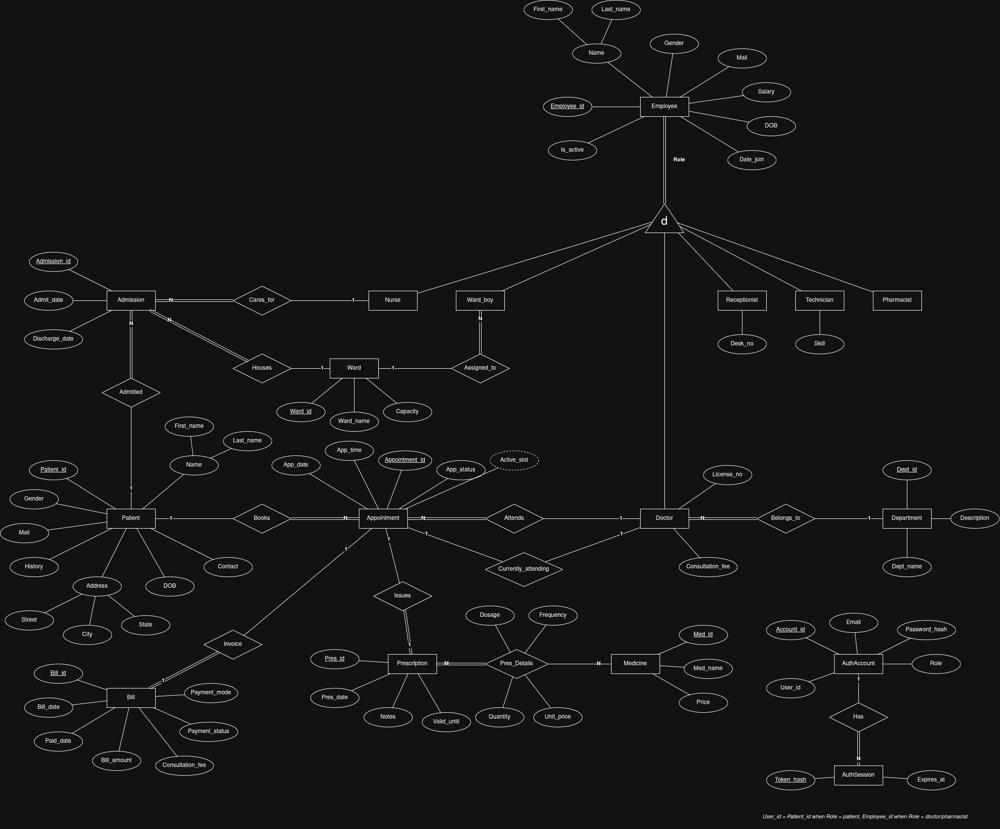

# HealthStack

HealthStack is a hospital management system built on a MySQL database. It covers the part of a hospital's day that a patient actually sees: finding a doctor, booking a slot, the consultation, the prescription and the bill.

There are three kinds of users, and each gets their own screens:

- **Patients** register and log in, browse departments and doctors, see a doctor's free slots, and book, cancel or reschedule appointments. They can see their past visits with the prescription and bill for each one.
- **Doctors** see today's queue. Opening an appointment shows the patient's details and their full visit history. Completing a visit records the prescription, and the system creates the bill.
- **Pharmacists** see every unpaid bill with the medicines prescribed, and mark bills as paid.

The database does more than store rows. Constraints and triggers enforce the hospital's rules, such as no double-booking, no prescription for a cancelled visit, and no change to a bill once it is issued. They apply no matter which program writes the data. Every multi-step action runs as a transaction, so it either completes fully or leaves nothing behind.

| Layer    | Technology                                                       | Folder      |
| -------- | ---------------------------------------------------------------- | ----------- |
| Database | MySQL 8.0.16+ (tables, constraints, triggers)                    | `backend/schema`, `backend/seed`, `backend/triggers` |
| Backend  | Python, FastAPI, `mysql-connector-python`                        | `backend/`  |
| Frontend | React, Vite, Tailwind CSS                                        | `frontend/` |

## Contents

1. [Running the project](#1-running-the-project)
2. [ER model](#2-er-model)
3. [Schema and normal forms](#3-schema-and-normal-forms)
4. [Triggers](#4-triggers)
5. [Transactions](#5-transactions)
6. [Concepts from class used here](#6-concepts-from-class-used-here)
7. [Known limitations](#7-known-limitations)

## 1. Running the project

```bash
# 1. Database (from the project root, inside the mysql client)
mysql -u root -p
mysql> SOURCE backend/schema/table.sql;   -- all tables + all triggers (wipes existing data)
mysql> SOURCE backend/seed/seed.sql;      -- demo data

# 2. Backend (http://127.0.0.1:8000, API docs at /docs)
cd backend
cp .env.example .env                      # then fill in your MySQL user and password
pip install -r requirements.txt
python server.py

# 3. Frontend (http://localhost:5173)
cd frontend
npm install
npm run dev
```

Demo logins (password `demo123` for all): `patient@demo.com`, `doctor@demo.com`, `pharmacist@demo.com`.

## 2. ER model



- **Employee** is specialised into Doctor, Nurse, Ward_boy, Receptionist, Technician and Pharmacist. The specialisation is **disjoint** (`d`), **total** (double line), and decided by the attribute `Role`.
- `Name` and `Address` are composite attributes; `Active_slot` is a derived attribute (dashed).
- `Pres_Details` is an M:N relationship with its own attributes (`Dosage`, `Quantity`, `Frequency`, `Unit_price`).
- `AuthAccount.User_id` is a `Patient_id` when `Role` = patient, and an `Employee_id` otherwise (note at the bottom of the diagram).
- **Technician**, **Admission** and their relationships (Admitted, Houses, Cares_for) are planned scope. They are in the diagram but not yet in `table.sql`.

## 3. Schema and normal forms

All tables are created by [`backend/schema/table.sql`](../backend/schema/table.sql). **Bold** marks the primary key, → marks a foreign key, and (U) marks a `UNIQUE NOT NULL` column.

| Table          | Columns                                                                                                                       |
| -------------- | ----------------------------------------------------------------------------------------------------------------------------- |
| `Department`   | **Dept_id**, Dept_name (U), Description                                                                                       |
| `Employee`     | **Employee_id**, First_name, Last_name, Gender, DOB, Date_join, Mail (U), Salary, Role, Is_active                             |
| `Doctor`       | **Employee_id** → Employee, License_no (U), Current_appointment_id, Dept_id → Department, Consultation_fee                    |
| `Nurse`        | **Employee_id** → Employee                                                                                                    |
| `Ward`         | **Ward_id**, Ward_name (U), Capacity                                                                                          |
| `Ward_boy`     | **Employee_id** → Employee, Ward_id → Ward                                                                                    |
| `Receptionist` | **Employee_id** → Employee, Desk_no                                                                                           |
| `Pharmacist`   | **Employee_id** → Employee                                                                                                    |
| `Patient`      | **Patient_id**, First_name, Last_name, Gender, DOB, Mail, Contact, Street, City, State, History                               |
| `Appointment`  | **Appointment_id**, Patient_id → Patient, Doctor_id → Doctor, App_date, App_time, App_status, Active_slot (generated)         |
| `Prescription` | **Pres_id**, Appointment_id → Appointment (U), Pres_date, Notes, Valid_until                                                  |
| `Medicine`     | **Med_id**, Med_name, Price                                                                                                   |
| `Pres_Details` | **(Pres_id → Prescription, Med_id → Medicine)**, Dosage, Quantity, Frequency, Unit_price                                      |
| `Bill`         | **Bill_id**, Appointment_id → Appointment (U), Consultation_fee, Bill_amount, Bill_date, Paid_date, Payment_status, Payment_mode |
| `AuthAccount`  | **Account_id**, Email (U), Password_hash, Role, User_id; `UNIQUE (Role, User_id)`                                             |
| `AuthSession`  | **Token_hash**, Account_id → AuthAccount, Expires_at                                                                          |

ER to tables: composite attributes are split into columns, each subclass is a table whose primary key is also a foreign key to `Employee`, and 1:1 relationships are a `UNIQUE` foreign key. `CHECK` constraints cover values such as gender, status, `Salary >= 0` and `Date_join > DOB`.

`Active_slot` is `1` for a live appointment and `NULL` for a cancelled one. `UNIQUE (Doctor_id, App_date, App_time, Active_slot)` and the same index on `Patient_id` stop double-booking. A unique index allows repeated `NULL`s, so a cancelled slot can be booked again.

### 3.1 Normal forms used

- **1NF**: every value is atomic, and the table has a key.
- **2NF**: 1NF, and no non-prime attribute depends on only part of a candidate key.
- **3NF**: for every non-trivial FD X → A, X is a superkey or A is prime (no transitive dependency).
- **BCNF**: for every non-trivial FD X → A, X is a superkey.

A table whose candidate keys are all single attributes is automatically in 2NF.

### 3.2 Normal form of each table

| Table          | Candidate keys                       | Non-trivial FDs                          | Highest NF | Reason                                                                 |
| -------------- | ------------------------------------ | ---------------------------------------- | ---------- | ---------------------------------------------------------------------- |
| `Department`   | Dept_id; Dept_name                   | each key → all                           | BCNF       | Only keys determine anything                                           |
| `Employee`     | Employee_id; Mail                    | each key → all                           | BCNF       | Role ↛ Salary (doctors 101 and 102 earn different salaries)            |
| `Doctor`       | Employee_id; License_no              | each key → all                           | BCNF       | Dept_id ↛ Consultation_fee: the fee is per doctor                      |
| `Nurse`        | Employee_id                          | none                                     | BCNF       | Single column                                                          |
| `Ward`         | Ward_id; Ward_name                   | each key → all                           | BCNF       | Only keys determine anything                                           |
| `Ward_boy`     | Employee_id                          | Employee_id → Ward_id                    | BCNF       | A ward has many ward boys, so Ward_id is not a key                     |
| `Receptionist` | Employee_id                          | Employee_id → Desk_no                    | BCNF       | Desks can be shared                                                    |
| `Pharmacist`   | Employee_id                          | none                                     | BCNF       | Single column                                                          |
| `Patient`      | Patient_id                           | Patient_id → all                         | BCNF       | Mail is nullable and not unique; City ↛ State (city names repeat across states) |
| `Appointment`  | Appointment_id                       | key → all; **App_status → Active_slot**  | **2NF**    | See note 1                                                             |
| `Prescription` | Pres_id; Appointment_id              | each key → all                           | BCNF       | One prescription per appointment                                       |
| `Medicine`     | Med_id                               | Med_id → all                             | BCNF       | Med_name is not unique                                                 |
| `Pres_Details` | (Pres_id, Med_id)                    | (Pres_id, Med_id) → rest                 | BCNF       | See note 2                                                             |
| `Bill`         | Bill_id; Appointment_id              | each key → all; **∅ → Consultation_fee** | **2NF**    | See note 3                                                             |
| `AuthAccount`  | Account_id; Email; (Role, User_id)   | each key → all                           | BCNF       | Neither Role nor User_id alone determines anything (no partial dependency) |
| `AuthSession`  | Token_hash                           | Token_hash → all                         | BCNF       | An account can have many sessions                                      |

**14 of 16 tables are in BCNF.** The two exceptions are deliberate or easy to fix:

1. **Appointment** stores the derived column `Active_slot`, so `Appointment_id → App_status → Active_slot` is transitive. MySQL computes the column itself (`GENERATED … STORED`), so it can never disagree with `App_status`. It exists only to make the unique index skip cancelled rows, which MySQL can't do any other way. Without it, the table is in BCNF.
2. **Pres_Details** might look like it has the partial dependency `Med_id → Unit_price`. It doesn't: `Unit_price` is the price at the time of prescribing, copied by a trigger, so the same medicine can have different prices in older and newer prescriptions. Dosage and quantity also vary per pair (medicine 1 is 10 tablets in prescription 1 and 6 in prescription 6).
3. **Bill**: trigger `trg_bill_bi` always sets `Consultation_fee = 200`, so the column is a constant. Any non-key attribute then determines it (for example `Bill_date → Consultation_fee`), which breaks 3NF. Copying the doctor's own `Consultation_fee` into the bill makes the table BCNF.

## 4. Triggers

`table.sql` installs all 25 triggers and one stored procedure. The same code is split by topic in [`backend/triggers/`](../backend/triggers/) (`install.sql` reinstalls them without touching data). Each rejects bad data with `SIGNAL SQLSTATE '45000'`, which the API returns as an HTTP 409.

| Trigger(s)                                    | Table (event)                   | Rule                                                                                 |
| --------------------------------------------- | ------------------------------- | ------------------------------------------------------------------------------------ |
| `check_employee_role` (procedure)             | —                               | Fails unless the employee exists with the given `Role`                               |
| `trg_<subclass>_role_bi / _bu` (10)           | 5 subclass tables (insert, update) | Row allowed only if `Employee.Role` matches the table: the **disjoint** specialisation |
| `trg_employee_role_lock`                      | Employee (update)               | `Role` can't change while the employee has a subclass row                            |
| `trg_employee_dates_bi / _bu`                 | Employee (insert, update)       | DOB in the past, join date not in the future, at least 18 when joining               |
| `trg_patient_dob_bi / _bu`                    | Patient (insert, update)        | DOB not in the future                                                                |
| `trg_prescription_bi / _bu`                   | Prescription (insert, update)   | Not for a cancelled appointment; not dated before the appointment                    |
| `trg_pres_details_bi`                         | Pres_Details (insert)           | Not once billed; sets `Unit_price` from `Medicine.Price`                              |
| `trg_pres_details_bu / _bd`                   | Pres_Details (update, delete)   | No change once billed; keeps the stored price                                        |
| `trg_prescription_bd`                         | Prescription (delete)           | Billed prescriptions can't be deleted (cascades don't fire triggers)                 |
| `trg_bill_bi`                                 | Bill (insert)                   | Not for a cancelled appointment; computes `Bill_amount = 200 + Σ(Quantity × Unit_price)` |
| `trg_bill_bu`                                 | Bill (update)                   | Amounts and appointment are frozen; only payment fields change                       |
| `trg_appointment_bi`                          | Appointment (insert)            | Doctor must be active                                                                |
| `trg_appointment_bu`                          | Appointment (update)            | New doctor must be active; a visit with a prescription or bill can't be cancelled    |

## 5. Transactions

These are the transactions listed in [`backend/transactions/README.md`](../backend/transactions/README.md), shown here as the backend actually runs them (long column lists trimmed). Each runs in Python through `mysql-connector`: `START TRANSACTION`, the statements with `%s` parameters, then `COMMIT`. Any error or failed check calls `ROLLBACK`.

**Login**

```sql
START TRANSACTION;
SELECT Account_id, Password_hash, Role, User_id FROM AuthAccount WHERE Email = %s AND Role = %s;
INSERT INTO AuthSession (Token_hash, Account_id, Expires_at)
VALUES (%s, %s, DATE_ADD(UTC_TIMESTAMP(), INTERVAL 1 DAY));
COMMIT;
```

The password is checked in Python against the scrypt hash between the two statements. Only the SHA-256 hash of the random session token is stored.

**Register (patient)**

```sql
START TRANSACTION;
SELECT Patient_id FROM Patient WHERE Mail = %s;            -- found: ROLLBACK
INSERT INTO Patient (First_name, Last_name, Mail, Contact, DOB, Gender) VALUES (%s, %s, %s, %s, %s, %s);
INSERT INTO AuthAccount (Email, Password_hash, Role, User_id) VALUES (%s, %s, 'patient', %s);
INSERT INTO AuthSession (Token_hash, Account_id, Expires_at) VALUES (%s, %s, DATE_ADD(UTC_TIMESTAMP(), INTERVAL 1 DAY));
COMMIT;
```

The three inserts commit together, so there is never a patient without a login. The new IDs come from `cur.lastrowid`.

**Logout**

```sql
DELETE FROM AuthSession WHERE Token_hash = %s;
```

A single statement, so it needs no explicit transaction.

**Book appointment**

```sql
START TRANSACTION;
SELECT e.Is_active FROM Doctor d JOIN Employee e ON e.Employee_id = d.Employee_id WHERE d.Employee_id = %s;
INSERT INTO Appointment (Patient_id, Doctor_id, App_date, App_time) VALUES (%s, %s, %s, %s);
COMMIT;
```

There is no "is the slot free?" query. The `UNIQUE` slot indexes reject a clash (error 1062), so two patients booking the same slot at the same moment can't both succeed.

**View appointments**

```sql
SELECT a.Appointment_id, a.App_date, a.App_time, a.App_status, e.First_name, e.Last_name
FROM Appointment a JOIN Employee e ON e.Employee_id = a.Doctor_id
WHERE a.Patient_id = %s ORDER BY a.App_date DESC, a.App_time DESC;
```

A read-only join, so it needs no transaction. The prescription and bill for each visit are fetched afterwards with `IN (…)`.

**Complete appointment (doctor)**

```sql
START TRANSACTION;
SELECT a.App_status, a.App_date FROM Appointment a JOIN Employee e ON a.Doctor_id = e.Employee_id
WHERE a.Appointment_id = %s AND a.Doctor_id = %s AND e.Is_active = TRUE FOR UPDATE;
INSERT INTO Prescription (Appointment_id, Pres_date, Notes, Valid_until) VALUES (%s, %s, %s, %s);
SELECT Price FROM Medicine WHERE Med_id = %s FOR UPDATE;                         -- for each medicine
INSERT INTO Pres_Details (Pres_id, Med_id, Quantity, Dosage, Frequency, Unit_price) VALUES (%s, %s, %s, %s, %s, %s);
INSERT INTO Bill (Appointment_id, Consultation_fee, Bill_amount, Bill_date) VALUES (%s, %s, %s, %s);
UPDATE Appointment SET App_status = 'Completed' WHERE Appointment_id = %s;
UPDATE Doctor SET Current_appointment_id = NULL WHERE Employee_id = %s AND Current_appointment_id = %s;
COMMIT;
```

`FOR UPDATE` locks the appointment, so a double click can't complete it twice. The bill trigger recomputes the total, and any failure undoes the prescription and bill together.

**Pay bill (pharmacist)**

```sql
START TRANSACTION;
SELECT Payment_status FROM Bill WHERE Bill_id = %s FOR UPDATE;                  -- not Pending: ROLLBACK
UPDATE Bill SET Payment_status = 'Paid', Payment_mode = 'Cash', Paid_date = %s WHERE Bill_id = %s;
COMMIT;
```

The row lock means two staff members can't both record the same payment.

The backend also runs **cancel** (one guarded `UPDATE … WHERE App_status = 'Scheduled' AND App_date > today`) and **reschedule** (`FOR UPDATE`, checks, then `UPDATE`).

## 6. Concepts from class used here

| Taught in the tutorials and lab                    | Where HealthStack uses it                                             |
| -------------------------------------------------- | --------------------------------------------------------------------- |
| `SELECT … WHERE … ORDER BY`                        | Doctor list, free slots, today's queue                                |
| `JOIN`, `LEFT JOIN`                                | Appointments with doctor and department; pending bills with an optional prescription |
| `COUNT`, `SUM`, subqueries                         | Dashboard counts; bill total and date checks inside triggers          |
| `START TRANSACTION`, `COMMIT`, `ROLLBACK`          | Every write in section 5                                              |
| `SELECT … FOR UPDATE`                              | Complete appointment, pay bill, reschedule                            |
| `BEFORE` triggers with `SIGNAL SQLSTATE '45000'`   | All 25 triggers                                                       |
| Trigger that sets `NEW.column`                     | `Unit_price` and `Bill_amount`                                        |
| `mysql.connector` with `%s` parameters, `try/except` + `rollback()` | Every endpoint (no string-built SQL, so no SQL injection) |

Used beyond the tutorials: one stored procedure, a `STORED` generated column, `ENUM`, `UNION`, and `IF EXISTS` inside triggers.

## 7. Known limitations

- `Technician` and `Admission` from the ER diagram are not implemented yet; `Employee.Role` still accepts `'Technician'`.
- The consultation fee is fixed at 200 (section 3.2, note 3).
- `AuthAccount.Role` has no `'receptionist'`, so only pharmacists can use the billing screens.
- Payments are always recorded as Cash; there is no payment gateway.
